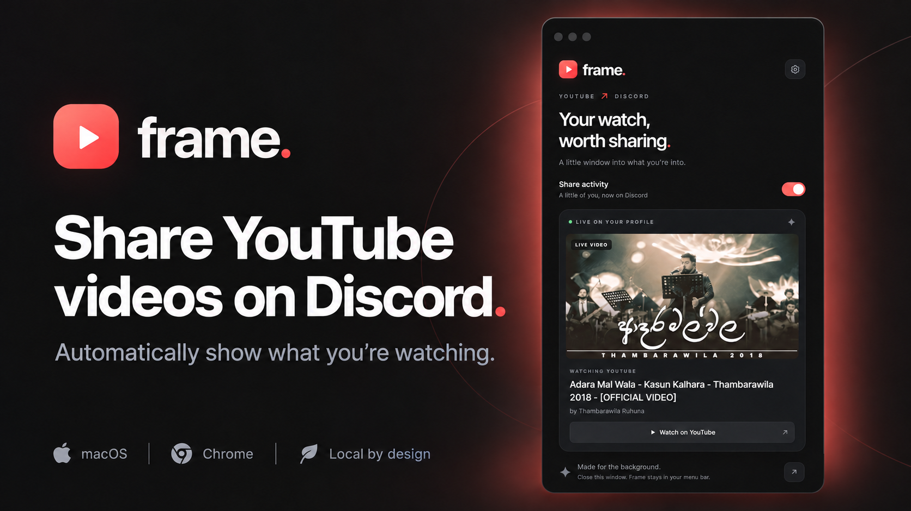
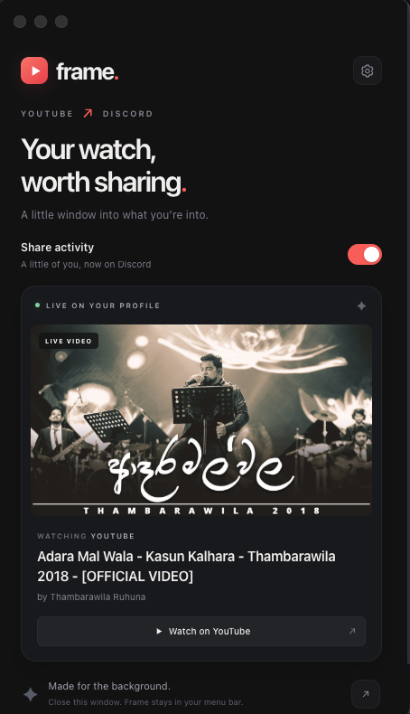

<p align="center">
  
</p>

<h1 align="center">Frame</h1>

<p align="center">
  <strong>Your watch, worth sharing.</strong><br>
  A small Mac menu-bar app that brings what you’re watching on YouTube to your Discord profile.
</p>

<p align="center">
  <strong>macOS</strong> &nbsp;·&nbsp; <strong>Google Chrome</strong> &nbsp;·&nbsp; <strong>Discord Rich Presence</strong> &nbsp;·&nbsp; <strong>MIT</strong>
</p>

<p align="center">
  <a href="#why-i-built-frame">The story</a> &nbsp; / &nbsp;
  <a href="#what-it-does">Features</a> &nbsp; / &nbsp;
  <a href="#get-started">Get started</a> &nbsp; / &nbsp;
  <a href="docs/SETUP.md">Full setup guide</a>
</p>

---

## Why I built Frame

I built this project because I wanted my Discord profile to show what I’m watching on YouTube—and I wanted it to look good.

The idea was simple: a video thumbnail, the title, the creator, and a way for friends to watch along. Something personal, with a clean interface and very little to manage.

Frame is my take on that idea. Pair it once, play a video in Chrome, and let it quietly do its thing.

## What it does

| Feature | The detail |
| --- | --- |
| **Your video, on your profile** | Shares the title, creator, thumbnail, and a **Watch on YouTube** button through Discord Rich Presence. |
| **A proper thumbnail preview** | Displays the full image in a **16:9** frame, using higher-resolution artwork when available. |
| **Playback-aware timing** | Updates for seeking and playback speed. Live videos skip the countdown. |
| **Automatic clearing** | Hides your presence when playback pauses, ends, switches to an ad, or the tab closes. |
| **Multiple tabs, handled** | Gives priority to the latest YouTube tab that starts playing. |
| **One sharing switch** | Turn sharing on or off from the app or its menu-bar menu. |
| **Quiet by default** | Close the window and keep Frame in your menu bar. Optionally start it with your Mac. |

<details>
<summary><strong>A closer look at the app</strong></summary>
<br>
<p align="center">
  
</p>
</details>

## Get started

You’ll need **macOS**, **Google Chrome**, **Discord desktop**, and **Node.js 22.12 or newer** with npm.

### 1. Run Frame

From the project folder:

```sh
npm install
npm start
```

Keep Discord desktop open and signed in.

### 2. Connect Discord

1. Open the [Discord Developer Portal](https://discord.com/developers/applications) and create a new application.
2. Name it **YouTube**. Discord uses this name in your presence heading.
3. Copy its **Application ID** from **General Information**.
4. Paste the ID into Frame and click **Connect**.
5. Enable activity sharing in Discord’s **User Settings → Activity Privacy**.

No bot account, Discord password, client secret, or Discord user token is needed.

### 3. Pair the Chrome extension

1. Open `chrome://extensions` in Google Chrome and enable **Developer mode**.
2. Choose **Load unpacked** and select this project’s [`extension/`](extension) folder.
3. Pin **Frame** from Chrome’s extensions menu.
4. In the Frame app, expand **Add to Chrome** and click **Get pairing code**.
5. Open the extension, enter the six-digit code, and click **Pair**.

Refresh any YouTube tabs that were already open, then play a video. You’re ready.

> Pairing codes last ten minutes and work once. Keep the extension folder in a permanent location so Chrome can continue loading it.

For packaged-app setup, daily use, and troubleshooting, see the [full setup guide](docs/SETUP.md).

## Private by design

- **YouTube only.** The extension reads video details on YouTube in regular Chrome windows.
- **Private windows stay private.** The extension cannot be enabled in incognito mode.
- **No saved watch history.** Video titles and viewing history are not written to disk.
- **No analytics or cloud backend.** Chrome talks to Frame through an authenticated local connection.
- **You choose when to share.** One switch hides your Discord presence.

Shared video details go to Discord for your presence, and public thumbnail images load from YouTube. Preferences and a local pairing credential are stored on your Mac.

## How it works

```text
YouTube in Chrome  →  Frame on your Mac  →  Your Discord presence
```

A lightweight Chrome extension reads the current video. Frame receives the details locally and updates the running Discord desktop client through Rich Presence.

The desktop app uses **Electron**, **HTML/CSS/JavaScript**, and **Node.js’s standard library** for its connection logic. The extension uses **Chrome Manifest V3** and needs no build step.

## Development

| Command | Purpose |
| --- | --- |
| `npm start` | Run the desktop app. |
| `npm run check` | Check JavaScript syntax, JSON, and extension assets. |
| `npm test` | Test playback handling, extension messaging, pairing, and Discord communication with a simulated client. |
| `npm run smoke` | Check the desktop interface with synthetic playback; no Discord activity is published. |
| `npm run build` | Package Frame for the current Mac and copy the Chrome extension into `dist/`. |

The build creates `dist/Frame-darwin-arm64/Frame.app` on Apple silicon, or `dist/Frame-darwin-x64/Frame.app` on Intel, plus `dist/Frame Chrome Extension/`.

Built app files are generated locally and excluded from Git. The current build is unsigned; signing and notarization are needed for broader distribution.

## A few things to know

- This version is built for **YouTube in Google Chrome on macOS**. It supports regular videos and Shorts; YouTube Music is outside its current scope.
- Discord desktop must be running with activity sharing enabled.
- Discord controls the final presence layout. Frame’s interface is its own preview of the video details.
- Your own Discord profile may hide the link button. Check from a friend’s account if needed.
- If Chrome disconnects unexpectedly, stale video activity expires after about 35 seconds.

## License

[MIT](LICENSE).

Built as a personal project. Frame is independent and is not affiliated with YouTube, Google, or Discord.

